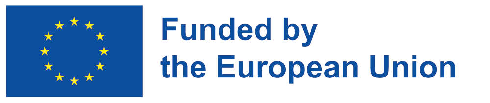
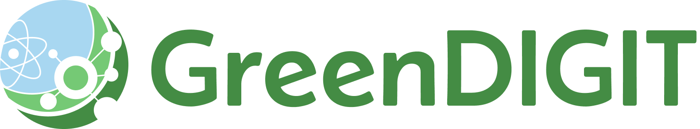

# Wattnet Documentation

Wattnet makes the environmental cost of electricity visible and actionable. It aggregates real-time, historical and forecasted data on the **carbon** and **water** impact of electricity consumption across Europe, and exposes it through an open REST API.

[Get Started :material-arrow-right:](user-guide/index.md){ .md-button .md-button--primary }
[Explore the API :material-arrow-top-right:](https://api.wattnet.eu/docs){ .md-button }

## Explore the docs

- :material-book-open-variant: **[User Guide](user-guide/index.md)**

    How to use the platform, the API and the Python client, and what each access level allows.

- :material-flask-outline: **[Methodology](methodology/index.md)**

    How carbon and water footprints are calculated.

- :material-sitemap-outline: **[Architecture](architecture/index.md)**

    System overview, C4 diagrams, and design decisions.

- :material-api: **[Technical Reference](reference/index.md)**

    Deployment and configuration of `wattnet-api`, `wattnet-core`, and `wattnet-forecast`.

## Key features

- :material-lightning-bolt: **Real-time data**

    Live carbon intensity and generation mix across all supported European zones.

- :material-history: **Historical data**

    Time series going back years, for long-term research and analysis.

- :material-chart-timeline: **Forecasted data**

    Day-ahead forecasts for carbon intensity and generation mix.

- :material-water: **Water footprint**

    Water consumption and withdrawal metrics for each energy source.

- :material-map: **Zone coverage**

    All ENTSO-E bidding zones plus GB (Elexon) and Turkey (EPIAS).

- :material-api: **Open API**

    A documented, versioned REST API with [interactive docs](https://api.wattnet.eu/docs).

## Wattnet on the web

- :material-web: **[wattnet.eu](https://wattnet.eu)**

    The project website.

- :material-view-dashboard-outline: **[dashboard.wattnet.eu](https://dashboard.wattnet.eu)**

    Explore the data on a map.

- :material-key-outline: **[developers.wattnet.eu](https://developers.wattnet.eu)**

    Create your API credentials.

- :material-api: **[api.wattnet.eu/docs](https://api.wattnet.eu/docs)**

    The interactive API reference.

## About the Service

- A service provided by the **[Spanish National Research Council (CSIC)](https://www.csic.es)**,
- Deployed on the **Scientific Cloud** at the **[Institute of Physics of Cantabria (IFCA)](https://ifca.unican.es/)**.
- Developed by the **[IFCA Advanced Computing and e‑Science Group](https://advancedcomputing.ifca.es)**.

## Trademark Information

The name **WATTNET** and the **Wattnet Logo** are official registered trademarks of the Spanish National Research Council (CSIC), recorded with the European Union Intellectual Property Office (EUIPO). The word mark is registered under [EUTM Application No. 019266832](https://euipo.europa.eu/eSearch/#details/trademarks/019266832), and the logo mark under [EUTM Application No. 019267422](https://euipo.europa.eu/eSearch/#details/trademarks/019267422).

## Terms of Use

Use of the Wattnet service, including the API and the dashboard, is subject to the [Wattnet terms](https://wattnet.eu/terms).

## Funding and Acknowledgments

This work was developed within the [GreenDIGIT](https://greendigit-project.eu/) project, funded by the European Union's Horizon Europe research and innovation programme under grant agreement No. [101131207](https://cordis.europa.eu/project/id/101131207), and by the Swiss State Secretariat for Education, Research and Innovation (SERI).

