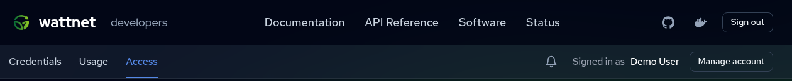
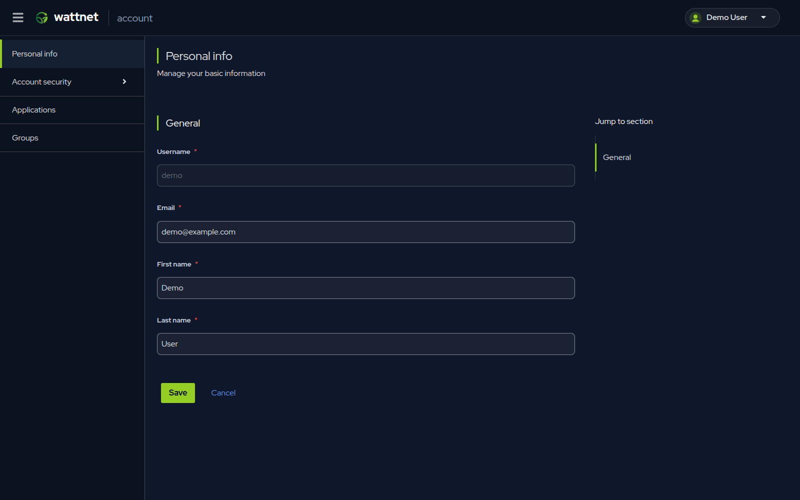
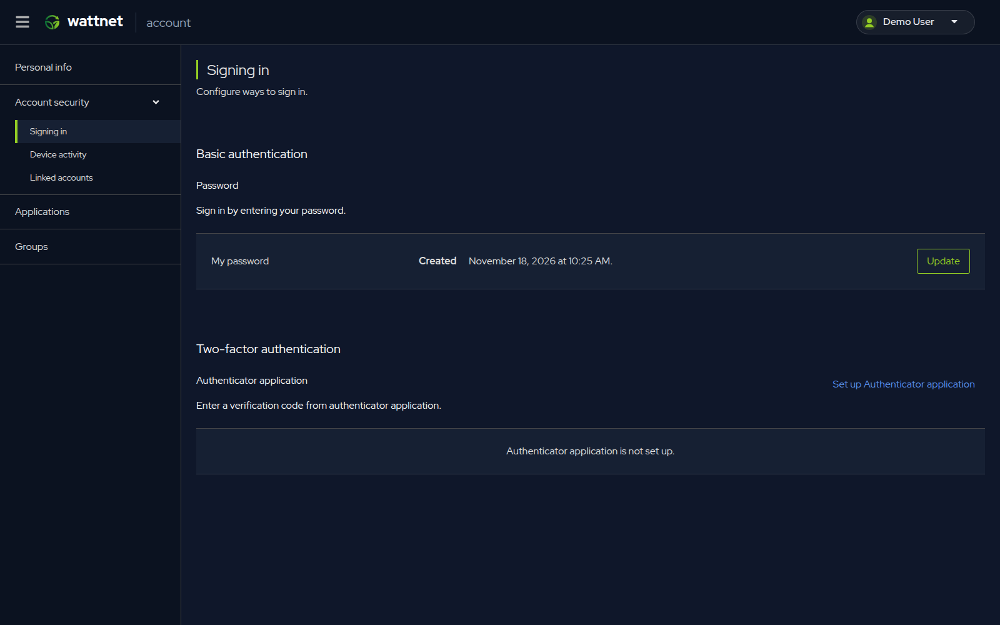
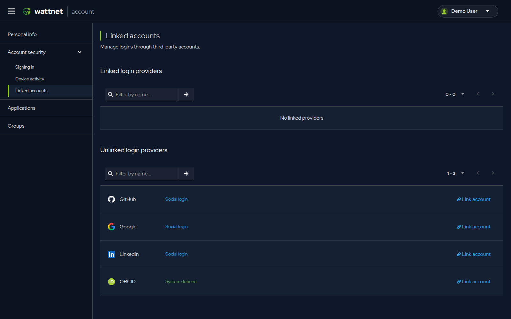
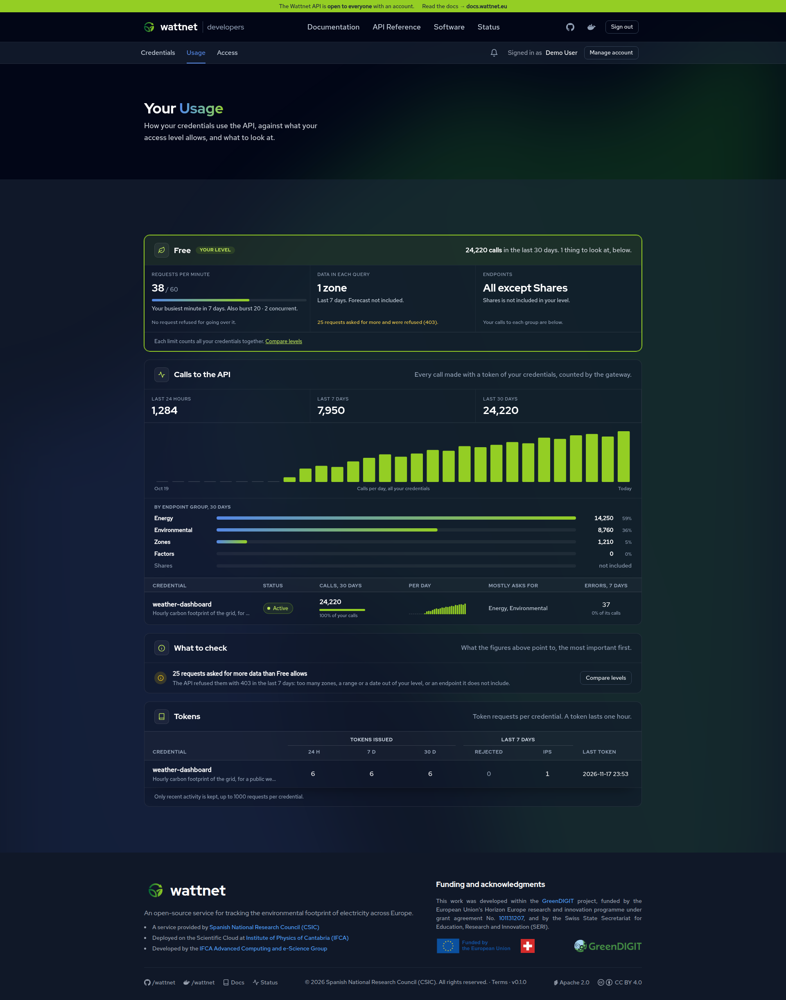
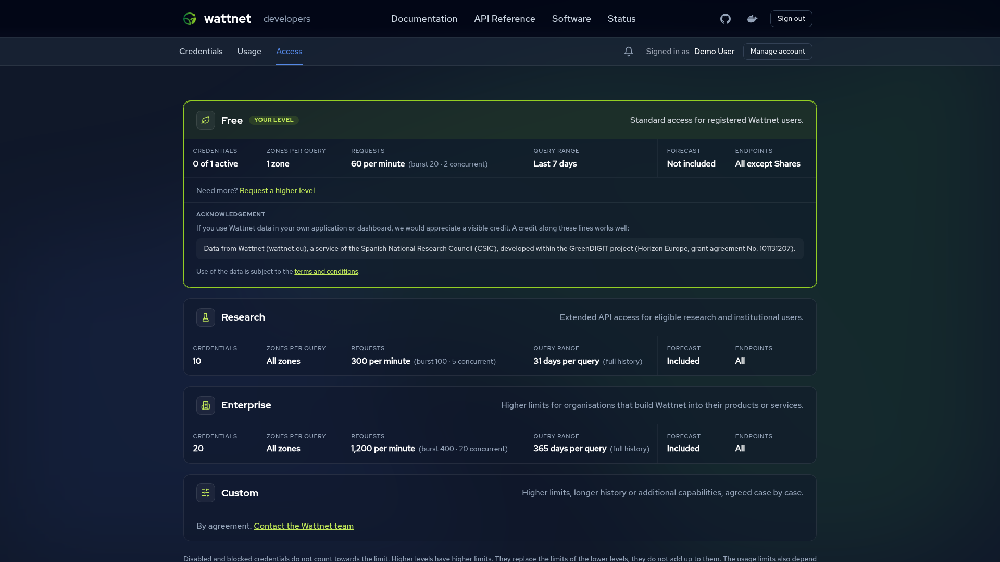
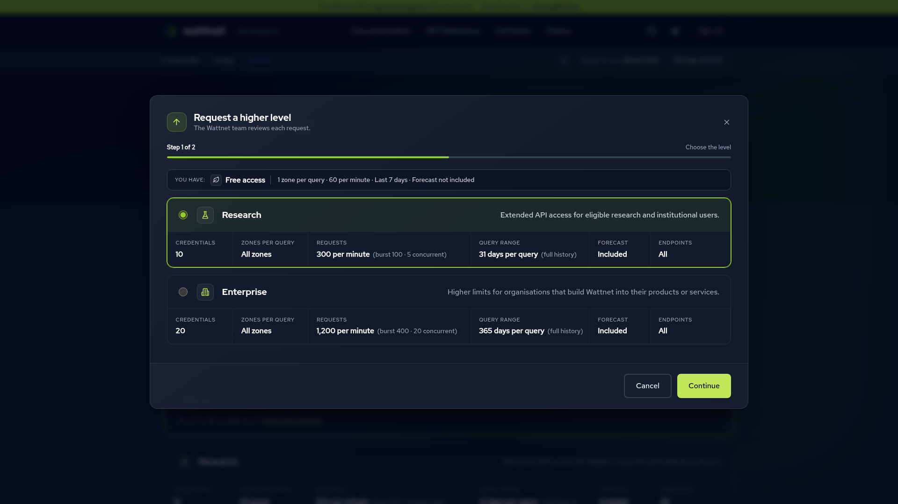
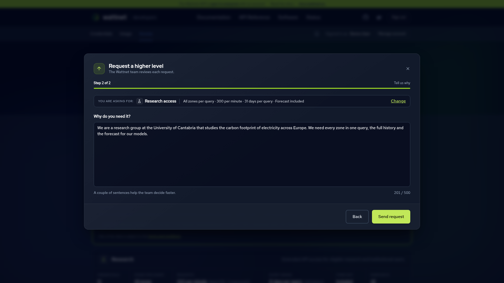
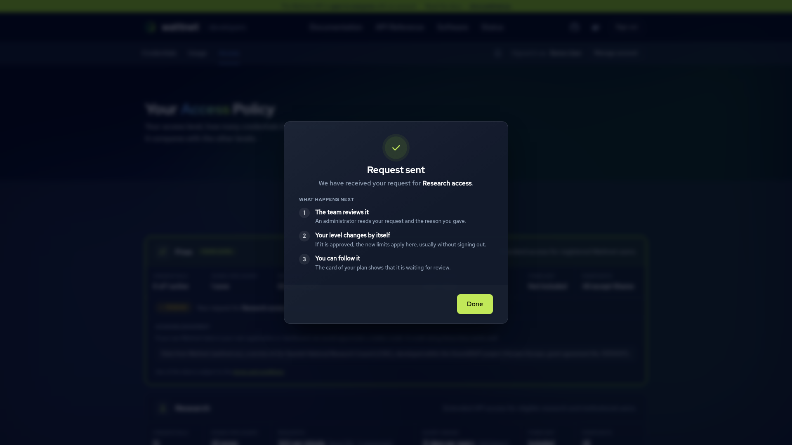
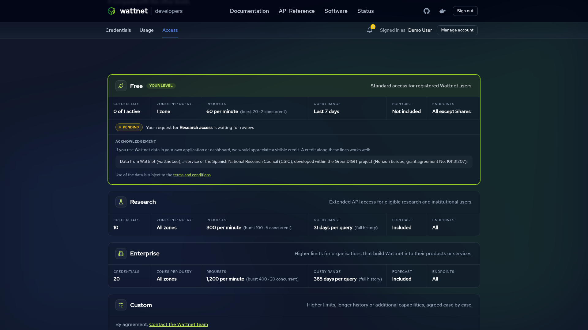

---
tags:
  - Access
  - Guide
---

# Account Management

Your Wattnet account is one person with one identity, however you sign in. Two places manage it:

| Where | What you manage there |
| --- | --- |
| **[Your account page](https://auth.wattnet.eu/realms/wattnet/account/)** | Who you are: your profile, your password and your third-party accounts. |
| **[The developer portal](https://developers.wattnet.eu)** | What you use the API with: your credentials, their usage and your access level. |

## Your account page

Open it from the [developer portal](https://developers.wattnet.eu) with **Manage account**, at the top right next to your name, or go straight to [auth.wattnet.eu/realms/wattnet/account](https://auth.wattnet.eu/realms/wattnet/account/).

The menu of the account page has:

- **Personal info**: your name and your email.
- **Account security**:
    - **Signing in**: change your password with **Update**, and set up two-factor authentication with an authenticator application.
    - **Device activity**: your sessions, and sign out of other devices.
    - **Linked accounts**: the third-party accounts that you can sign in with, see below.
- **Applications** and **Groups**: the applications that have access to your account and the groups you belong to.

If you forget your password, use **Forgot password** on the sign-in page to get a link by email. If you can no longer use your email or your linked accounts, get in touch through [wattnet.eu/contact](https://wattnet.eu/contact).

### Linking a third-party account

You can sign in with GitHub, Google, ORCID or LinkedIn instead of a password. The account comes first and the provider is linked to it:

1. [Register](../api/api-access.md#1-create-a-credential) a Wattnet account, or accept an invitation, and sign in with your password.
2. In your account page, open **Account security** and then **Linked accounts**, and press **Link account** next to the provider.
3. Confirm, sign in to the provider when it asks and you come back linked.

From then on, **Sign in with** that provider signs you in to the same account, with the same credentials and the same [access level](user-access-policy.md).

!!! info "A third-party account never creates an account"

    If you press **Sign in with GitHub** and that GitHub account is not linked, you are told so and nothing is created, even if the email is the same. Link it from your account while you are signed in. A provider can be linked to one Wattnet account only.

## The developer portal

[developers.wattnet.eu](https://developers.wattnet.eu) has three pages, and all of them follow your account, however you sign in.

### Credentials

Create one `client_id` and `client_secret` per service, regenerate a secret, disable or delete a credential and get a token to try by hand. The steps are in [API Access](../api/api-access.md#1-create-a-credential).

### Usage

How your credentials use the API against what your [access level](user-access-policy.md) allows, and what to look at.

- **Your level against its limits**: the requests per minute of your busiest minute in the last 7 days, the data a query may ask for and the endpoints included, and whether any request was refused for asking for more.
- **Calls to the API**: the calls of the last 24 hours, 7 and 30 days, per day, per group of endpoints and per credential (status, errors and what it mostly asks for).
- **What to check**: what the figures point to, the most important first. For example, requests refused with a `403` because the query went beyond your level.
- **Tokens**: the tokens each credential asked for, the rejected requests, the distinct IP addresses and the last token. It helps you spot a credential nobody uses any more, or one used from an unexpected place.

Each limit counts all your credentials together.

### Your access level

The **Access** page shows your level, what it allows and how many credentials you use.

To ask for a higher level, press **Request a higher level**, choose the level and say why you need it.

The Wattnet team reads the request and approves or rejects it with a note, and the portal tells you. While it waits, the card of your level says so.

When it is approved, the new level applies in the portal, usually without signing out, and to your credentials the next time they get a token. You do not need to create new credentials. The levels and their limits are in the [User Access Policy](user-access-policy.md).
