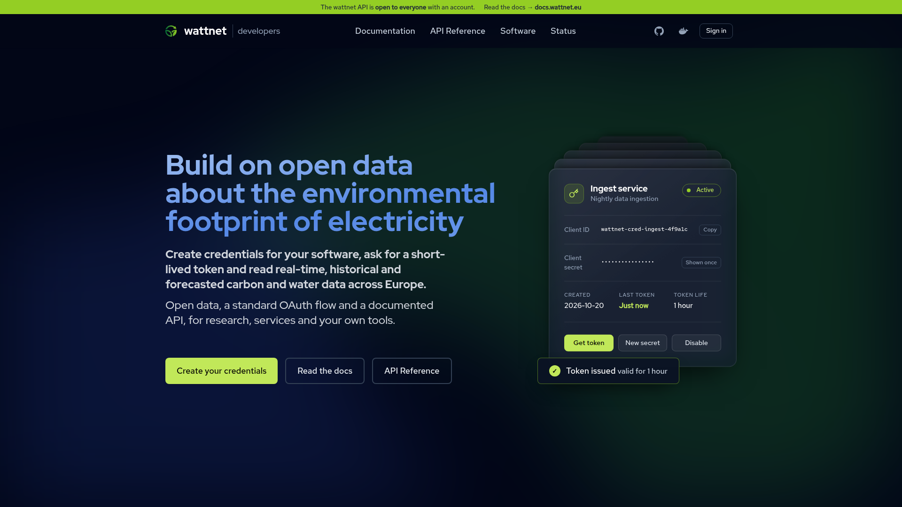
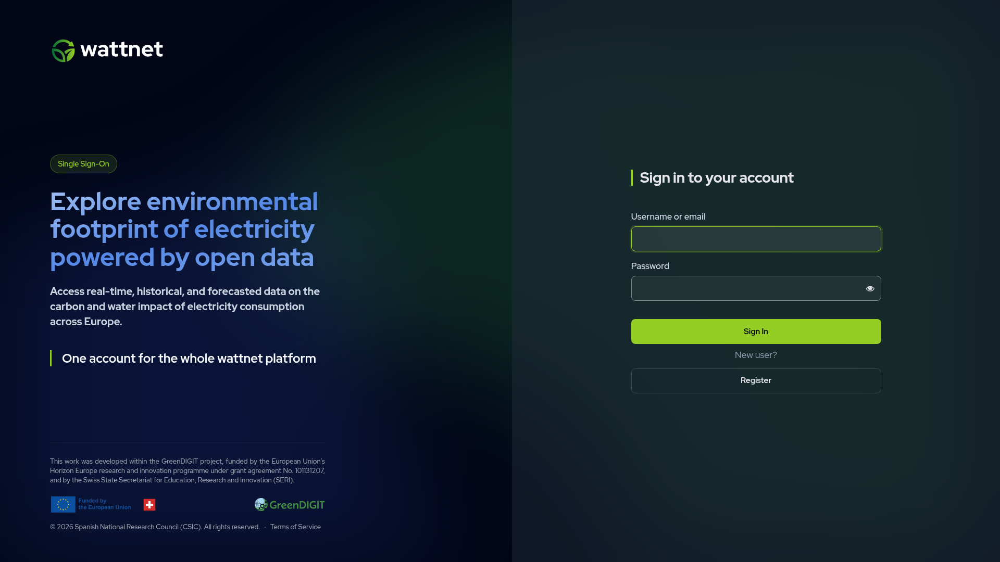
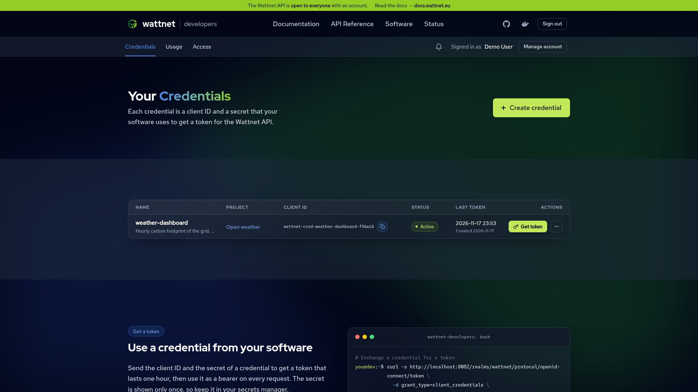
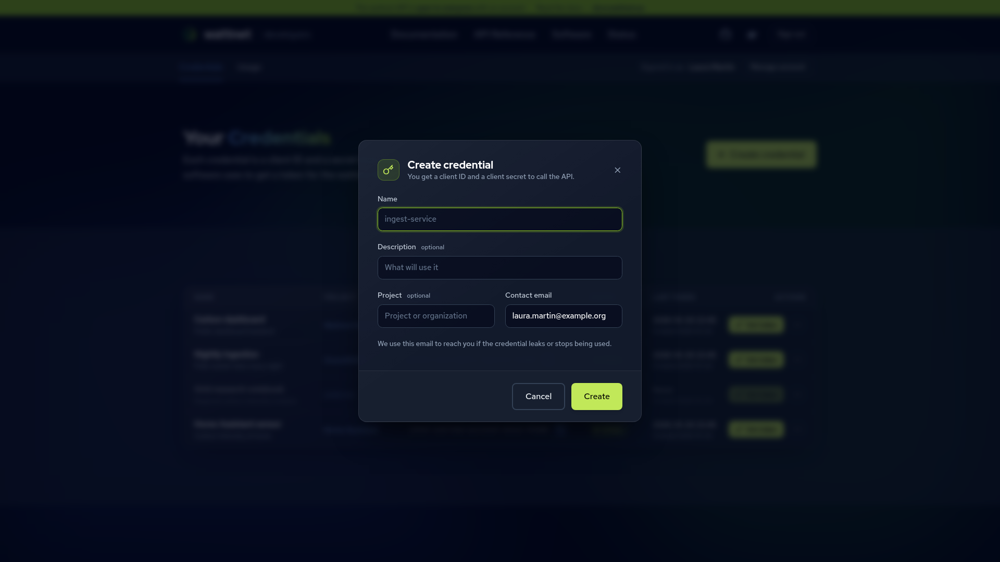
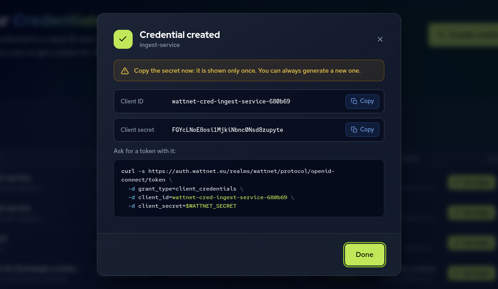
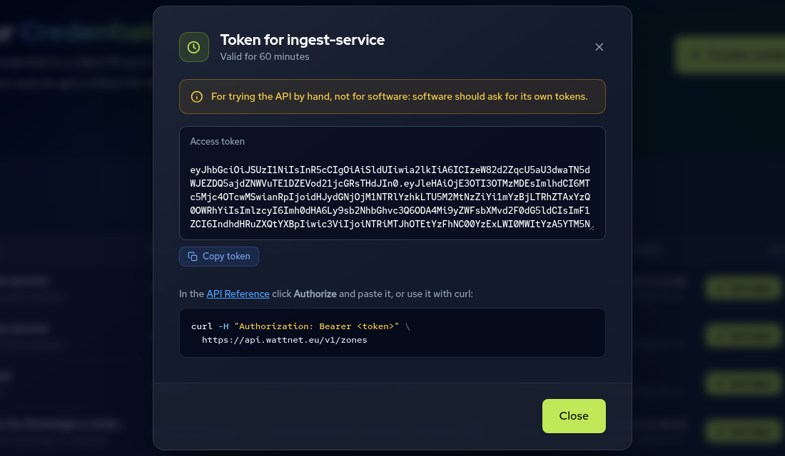
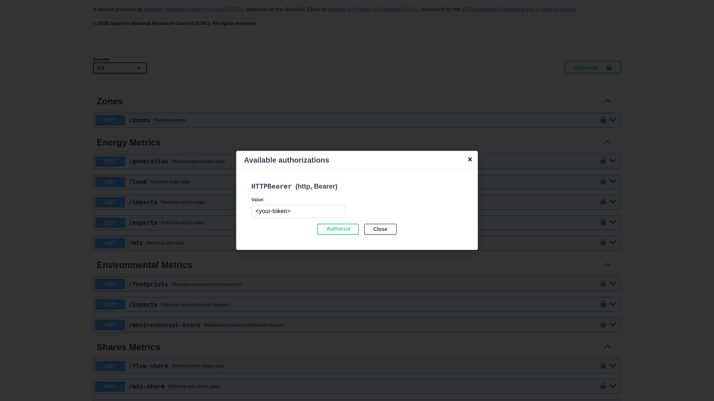
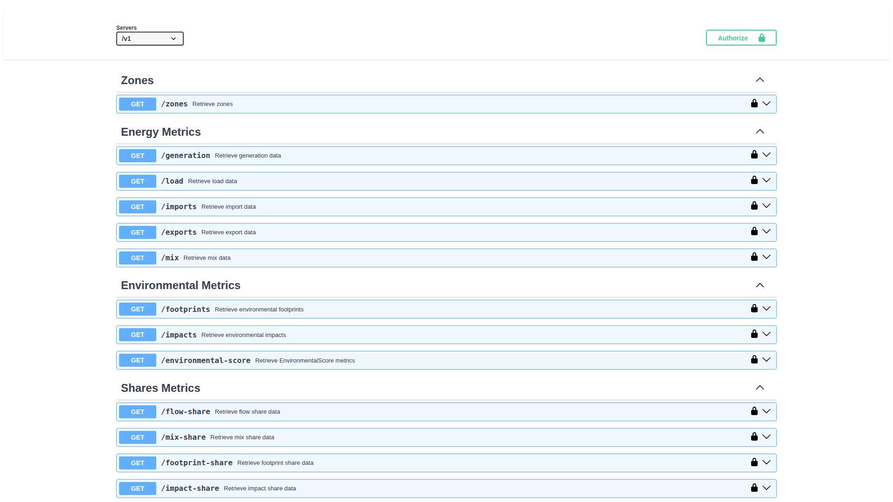

---
tags:
    - API
    - Guide
---

# API Access

To use the API you authenticate with a credential, a `client_id` and `client_secret` that you create in the developer portal, and exchange it for a short-lived Bearer token. Use of the API is subject to the [Wattnet terms](https://wattnet.eu/terms), and what you can ask of it depends on your [access level](../access/user-access-policy.md).

!!! warning "Still using an email and a password?"

    That token service is deprecated and stops working on 28 February 2027. Create a credential and move to it, see [Legacy token service](#legacy-token-service).

## 1. Create a credential

Sign in to the [developer portal](https://developers.wattnet.eu) with your Wattnet account.



!!! info "No account yet?"

    Press **Sign in** and then **Register**, and fill in the form. Once your email is verified you can create credentials right away, with the [Free level](../access/user-access-policy.md#free). If you linked a third-party account to your Wattnet account, you can also sign in with it, see [Account Management](../access/account-management.md#linking-a-third-party-account).

    

The **Credentials** page lists your credentials with their client ID, status and last token. Press **Create credential**.



Name it after what will use it, for example the service. The description, the project and the contact email help you and the team recognise it, and the email is where we write if the credential leaks or stops being used.



The portal shows the `client_secret` once, with the client ID and a ready-to-use `curl` command. Copy it now to a secrets manager or an environment variable. If you lose it, generate a new one.



Create one credential per service. You can regenerate a secret if it leaks, and disable, enable or delete a credential at any time. Never put a secret in code or in a repository, and do not share a credential between people or services. How many active credentials you can have depends on your [level](../access/user-access-policy.md#2-access-levels).

## 2. Obtain a token

Exchange the credential for an access token with the standard OAuth 2.0 `client_credentials` grant:

```bash
curl -s https://auth.wattnet.eu/realms/wattnet/protocol/openid-connect/token \
  -d grant_type=client_credentials \
  -d client_id=<your_client_id> \
  -d client_secret=$WATTNET_CLIENT_SECRET
```

The response is `{"access_token": "...", "expires_in": 3600, "token_type": "Bearer"}`. A token is valid for 1 hour: reuse it until it is about to expire instead of requesting one per call.

Any standard OAuth library can do this for you, reading the token endpoint from the [discovery document](https://auth.wattnet.eu/realms/wattnet/.well-known/openid-configuration). The [Python client](../python-client/python-client-authentication.md) does it automatically.

The token carries your access level, so a change of level reaches your credentials the next time they get a token.

## 3. Query the API

Send the token as a Bearer token:

```bash
curl --compressed "https://api.wattnet.eu/v1/footprints?zone=ES&footprint_type=carbon" \
  -H "Authorization: Bearer <your_token>"
```

`--compressed` asks for a compressed answer. The results carry data quality flags, explained in the [API Data Model](api-data-model.md). The resolution of the series, the errors, caching and compression are in [Querying the API](api-usage.md).

## Trying the API by hand

Each credential in the developer portal has a **Get token** button, for testing with `curl`, Postman or the interactive documentation. The token is valid for 60 minutes and the portal does not store it. It is for trying things by hand: software should ask for its own tokens.



In the interactive documentation at [api.wattnet.eu/docs](https://api.wattnet.eu/docs), press **Authorize**, paste the token and press **Authorize** again. The token is not stored in your browser.



The lock of every endpoint closes, and the requests you send from the page carry your token.



## Legacy token service

!!! warning "Deprecated"

    The previous token service, which exchanges an email and a password for a token at `https://api.wattnet.eu/token-request/get_token`, is **legacy** and stops working on **28 February 2027**. It still works for people who registered before and new registrations are closed. A successful answer carries the `Deprecation` and `Sunset` headers, and `Sunset` gives the date.

Its tokens last 1 day and are sent as a Bearer token, like any other. Until the date they keep working as they always did.

Move to a credential before then. A credential gives you your own token that you can revoke, a [usage page](../access/account-management.md#usage) and the limits of your [level](../access/user-access-policy.md).

## Authentication errors

- **401 when querying the API**: the Bearer token is missing, malformed or has expired. Repeat [step 2](#2-obtain-a-token) for a fresh one.
- **401 or 400 when obtaining a token**: the `client_id` or `client_secret` is wrong, or the credential was revoked or its secret regenerated. Check them in the developer portal.

The `403`, `429` and the other errors of the API are in [Querying the API](api-usage.md#errors).

## Getting support

For any issue with your credentials, get in touch through [wattnet.eu/contact](https://wattnet.eu/contact).
