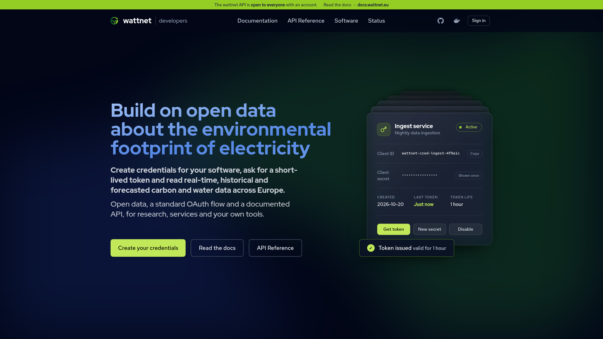
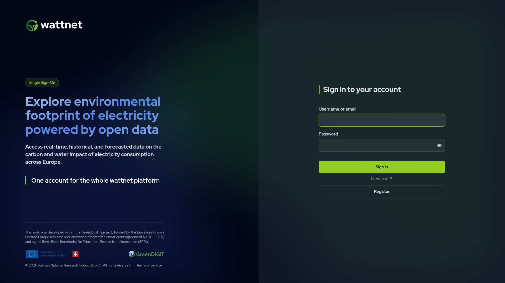
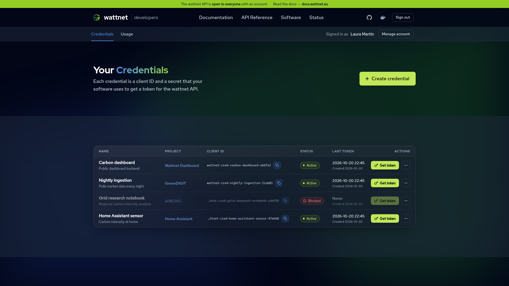
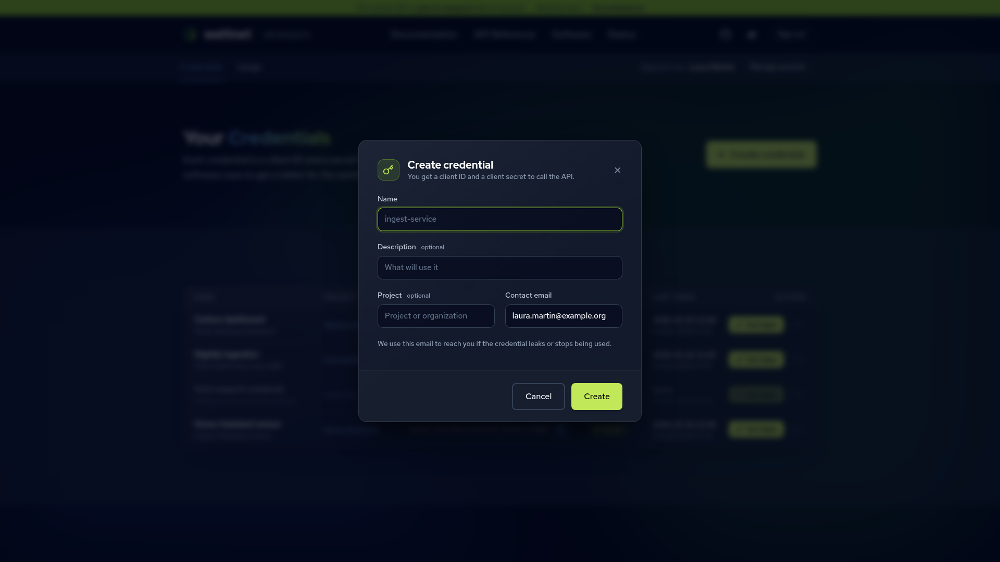
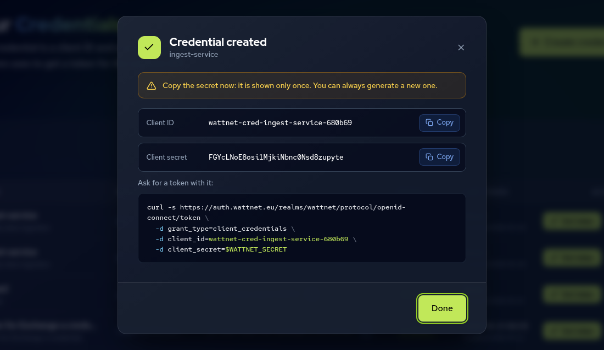
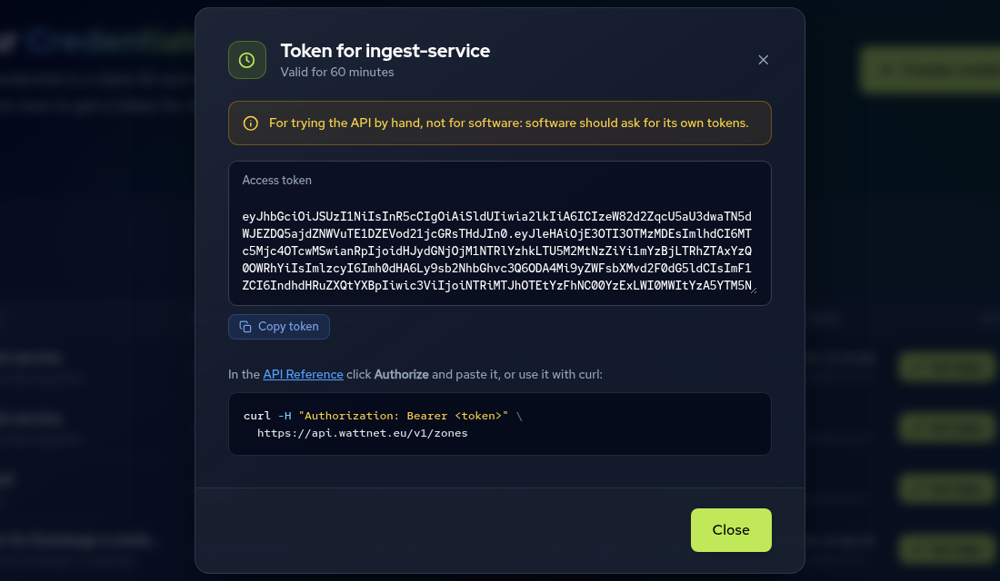
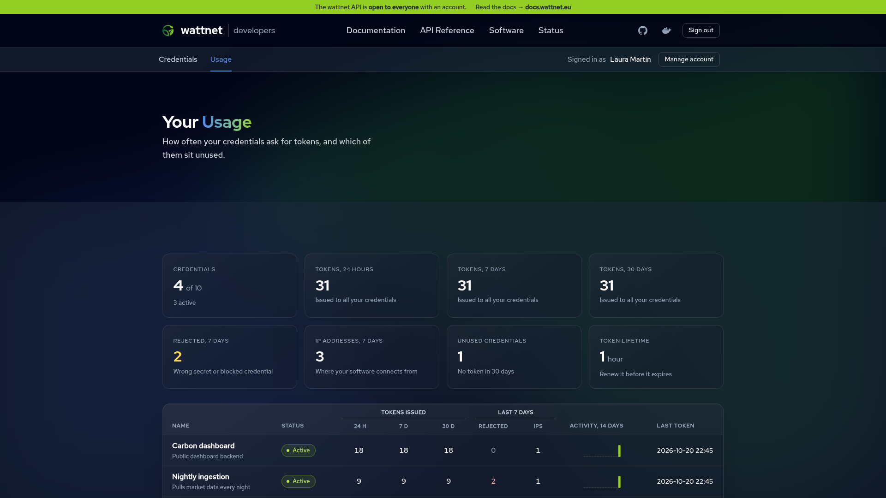

---
tags:
    - API
    - Guide
---

# API Access

The Wattnet API lets you query carbon and water footprint data programmatically. You authenticate with a credential, a `client_id` and `client_secret` pair that you create yourself in the developer portal, and exchange it for a short-lived Bearer token.

Use of the API is subject to the [Wattnet terms](https://wattnet.eu/terms).

!!! warning "Still using an email and a password?"

    That token service is deprecated. Create a credential and move to it, see [Legacy token service](#legacy-token-service).

## 1. Create a credential

Sign in to the [developer portal](https://developer.wattnet.eu) with your Wattnet account.



!!! info "No account yet?"

    Register for one: press **Sign in** in the developer portal and choose **Register** on the sign-in page.

    

    Fill in the registration form. Once your email is verified, you can create credentials right away.

The **Credentials** page lists your credentials with their client ID, status and the time of their last token. Press **Create credential**.



Give it a name that tells you what it is for, for example the name of the service that will use it. The description, the project and the contact email help you and the team to recognise it, and the email is where we write if the credential leaks or stops being used.



The portal shows the `client_secret` once, together with the client ID and a ready-to-use `curl` command. Copy it now and store it in a secrets manager or an environment variable. If you lose it, you can always generate a new one.



You can create one credential per service, regenerate a secret if it leaks, and disable, enable or delete a credential at any time. Never share a credential between people or services, and never put the secret in code or in a repository.

## 2. Obtain a token

Exchange the credential for an access token with the standard OAuth 2.0 `client_credentials` grant:

```bash
curl -s https://auth.wattnet.eu/realms/wattnet/protocol/openid-connect/token \
  -d grant_type=client_credentials \
  -d client_id=<your_client_id> \
  -d client_secret=$WATTNET_CLIENT_SECRET
```

The response is `{"access_token": "...", "expires_in": 3600, "token_type": "Bearer"}`. Tokens are valid for 1 hour. Reuse a token until it is about to expire instead of requesting one per call, and request a new one when it does.

The token endpoint can be read from the issuer's discovery document at `https://auth.wattnet.eu/realms/wattnet/.well-known/openid-configuration`, so any standard OAuth library can obtain tokens for you. The [Python client](../python-client/python-client-authentication.md) does it automatically.

## 3. Query the API

```bash
curl -X GET "https://api.wattnet.eu/v1/footprints?footprint_type=carbon…" \
  -H "Content-Type: application/json" \
  -H "Authorization: Bearer <your_token>"
```

Results include data quality flags (`zone_status` and `valid`); see the [API Data Model](api-data-model.md) for how to interpret them.

## Trying the API by hand

Each credential in the developer portal has a **Get token** button that returns a token for it, meant for testing with `curl`, Postman or the interactive documentation. The token is valid for 60 minutes and the portal does not store it. It is for trying the API by hand: software should ask for its own tokens.


 In the interactive documentation at [api.wattnet.eu/v1/docs](https://api.wattnet.eu/v1/docs), press **Authorize** and paste the token. The token is not stored in your browser.

## Checking the usage

The **Usage** page shows, for each credential, the tokens it requested in the last 24 hours, 7 and 30 days, the rejected requests, the distinct IP addresses and a 14-day activity chart. It helps you spot a credential nobody uses any more, or one that is used from a place you do not expect.



## Legacy token service

!!! warning "Deprecated"

    The previous token service, which exchanged an email and a password for a token at `https://api.wattnet.eu/token-request/get_token`, is **legacy** and will be switched off. It still works for people who registered before, new registrations are closed, and its responses carry the `Deprecation` and `Sunset` headers. The `Sunset` header gives the date it stops working.

    **Move to a credential** by following the steps above before that date. A credential gives you your own token, that you can revoke, and a place to check its usage, which the legacy token does not.

## Common errors

- **401 Unauthorized when querying the API**: your Bearer token is missing, malformed, or has expired. Tokens are valid for 1 hour; repeat [step 2](#2-obtain-a-token) to get a fresh one.
- **401 or 400 when obtaining a token**: the `client_id` or the `client_secret` is wrong, or the credential was revoked or its secret regenerated. Check them in the developer portal.
- **403 Forbidden when querying the API**: the credential is valid but is not allowed to use that endpoint.

## Getting support

For any issue with your credentials, such as trouble creating one or obtaining a token, get in touch through [wattnet.eu/contact](https://wattnet.eu/contact).
