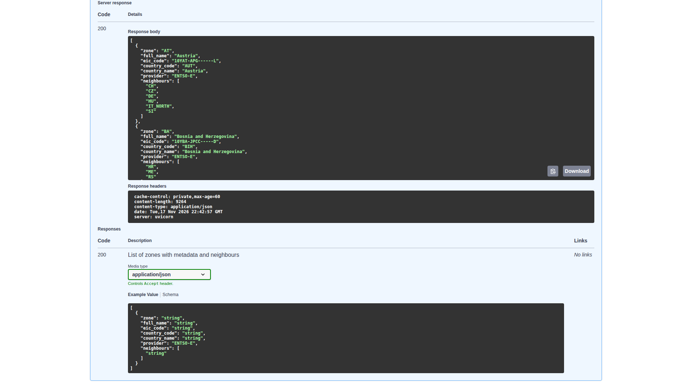

---
tags:
  - API
  - Guide
---

# API Documentation

The interactive documentation is at [api.wattnet.eu/docs](https://api.wattnet.eu/docs). It is a Swagger UI where you browse every endpoint and query parameter, such as the zones and the metrics (carbon, water, environmental score), and try requests from the browser.

For what the answers contain see the [API Data Model](api-data-model.md), and for the resolution, errors, caching and compression, [Querying the API](api-usage.md).

## Trying a request

Press **Authorize** and paste a token, see [API Access](api-access.md#trying-the-api-by-hand). Then open an endpoint, press **Try it out**, fill in the parameters and press **Execute**. The page shows the `curl` command and the status, body and headers of the answer, such as `cache-control`.

## API versioning

The current version is `v1`, at [https://api.wattnet.eu/v1/](https://api.wattnet.eu/v1/). Changes inside `v1` only add: a new field, parameter or endpoint never removes or changes what an existing client reads. A field that is going to be removed is first marked as deprecated in the interactive documentation, with the date it goes. Today that is `values`, see [Series: `points` and `values`](api-data-model.md#series-points-and-values).
