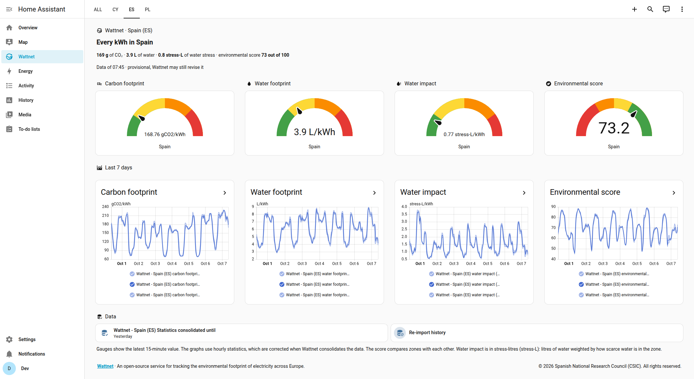
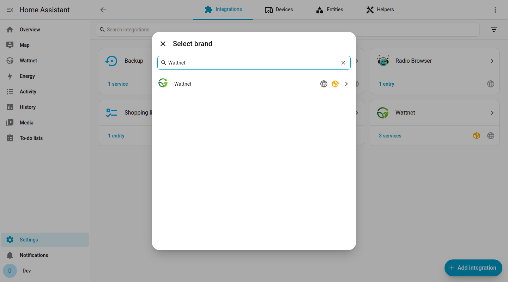
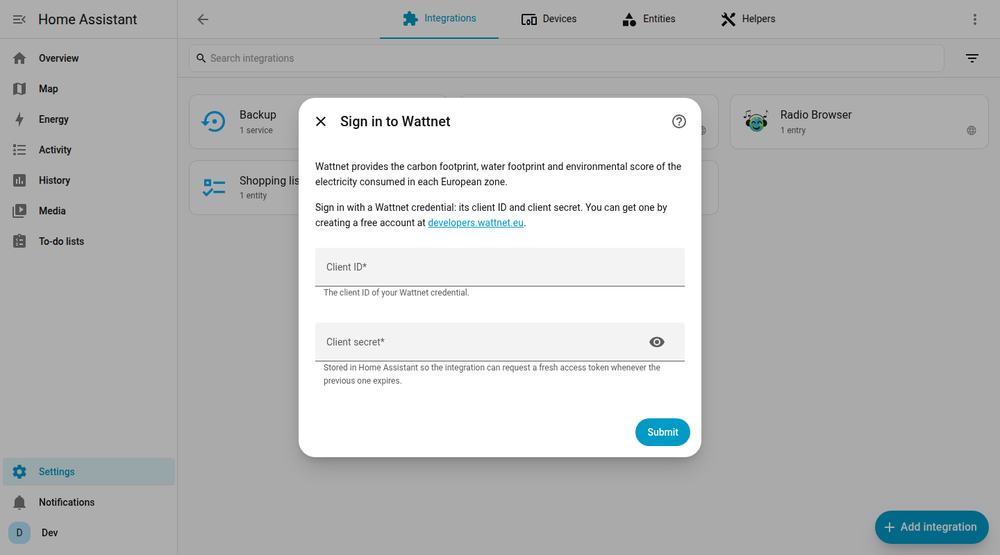
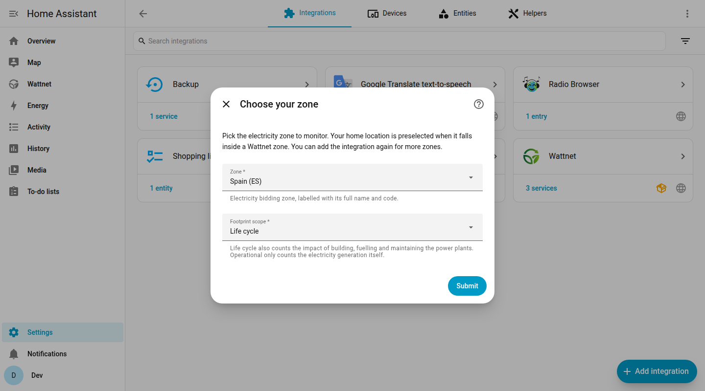
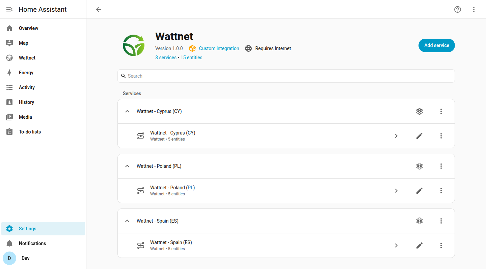
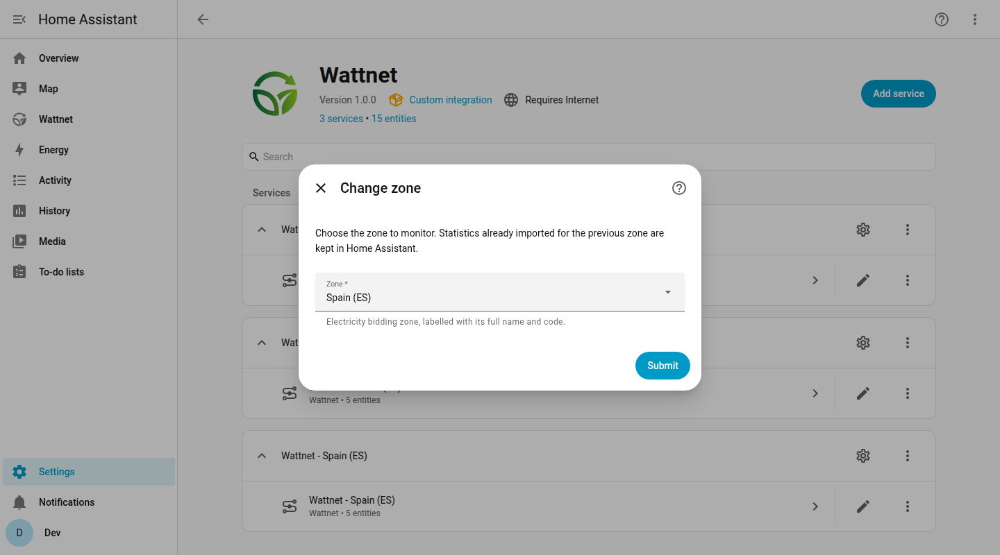

---
tags:
  - Home Assistant
  - Guide
---

# Home Assistant Integration

The Wattnet integration brings the carbon footprint, water footprint, water impact and environmental score of the electricity consumed in your zone into [Home Assistant](https://www.home-assistant.io/). It is built on the official [Python client](../python-client/python-client-quickstart.md) and on the [Wattnet API](../api/api-access.md).

{ loading=lazy }

## What you get

- **Sensors** with the latest value of each metric in the zone you choose, so you can use them in automations, scripts and your own dashboards.
- **Long-term statistics** with the history of each metric, so the graphs of Home Assistant show the data with the right timestamps. Recent data is published as provisional and later consolidated by Wattnet, and the integration corrects the history by itself when that happens.
- **A ready-made dashboard** in the sidebar, with gauges and graphs for every zone you set up. See [Dashboard and entities](home-assistant-dashboard.md).
- **Your own footprint**: when your Energy dashboard has a grid source, the integration crosses your consumption with the footprint of each kWh. See [Reference](home-assistant-reference.md#energy-dashboard).

## Requirements

- Home Assistant 2025.11 or newer.
- A Wattnet credential (client ID and client secret). Create a free account in the [developer portal](https://developers.wattnet.eu) and create the credential there, as described in [API Access](../api/api-access.md#1-create-a-credential).

## Installation

### With the Marketplace (recommended)

The [Marketplace](https://www.home-assistant.io/integrations/marketplace/) is built into Home Assistant 2026.11 and newer, and replaces HACS. It is under **Settings > Marketplace** and only administrators can open it. The first time you open it, accept the warning about community content.

1. Go to **Settings > Marketplace** and select **Add from link** in the upper right corner.
2. Under **GitHub link**, enter `https://github.com/wattnet/wattnet-home-assistant` and select **Add**. If you have not connected GitHub yet, the Marketplace asks you to do it now: it shows a code and a link, and you approve the connection on GitHub.
3. Open the **Wattnet** page, select **Install**, check the version and select **Install** again.

When the installation finishes, the Marketplace opens the setup of the integration if it can load right away. If not, restart Home Assistant when the Marketplace asks you to and add the integration as described below. Updates appear under **Settings > Updates**, and after an update you restart Home Assistant.

!!! note "Coming from HACS"
    If you installed the integration with HACS, Home Assistant 2026.11 moves it to the Marketplace by itself and keeps it updated. You do not have to install it again.

### Manual

On Home Assistant versions older than 2026.11, or without a GitHub account, copy the `custom_components/wattnet` folder of the [GitHub repository](https://github.com/wattnet/wattnet-home-assistant) into the `custom_components` folder of your Home Assistant configuration and restart Home Assistant.

## Set up the integration

Go to **Settings > Devices & services**, press **Add integration** and search for **Wattnet**.

{ loading=lazy }

### 1. Sign in

Enter the client ID and client secret of your Wattnet credential.

{ loading=lazy }

!!! note "Why a credential, and not a token"
    A token expires after one hour. With the credential the integration requests a fresh token whenever it needs one, so it never stops working when a token expires. The client secret is stored in your Home Assistant.

If Wattnet later rejects the stored credential, for example because you regenerated its secret or deleted it in the developer portal, Home Assistant asks you to sign in again with the client ID and the current client secret.

### 2. Choose the zone and the scope

Pick the electricity zone to monitor. Your home location is preselected when it falls inside a Wattnet zone. Then pick the footprint scope:

- **Life cycle** also counts the impact of building, fuelling and maintaining the power plants.
- **Operational** only counts the electricity generation itself.

{ loading=lazy }

### 3. Done

The integration creates one device with its sensors and adds the **Wattnet** dashboard to the sidebar. The sensors are ready right away, while the history is downloaded in the background, so Home Assistant is never slowed down by it. After a few minutes the graphs of the last 7 days are complete.

{ loading=lazy }

## Monitor more zones

One entry is created per zone. To monitor more zones, press **Add service** in the Wattnet integration page and repeat the steps above. With several zones the dashboard compares them all.

## Change the zone

Open the menu of an entry (the three dots) and choose **Reconfigure**. The statistics already imported for the previous zone are kept in Home Assistant.

{ loading=lazy }

## Next steps

- [Dashboard and entities](home-assistant-dashboard.md): what the dashboard and the sensors show.
- [Reference](home-assistant-reference.md): options, statistics, the Energy dashboard, the action to re-import history and troubleshooting.
