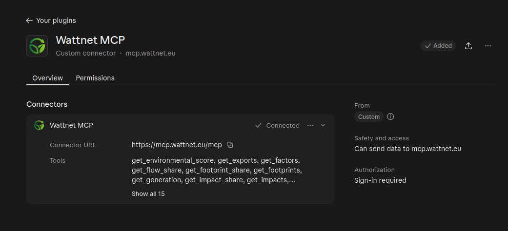
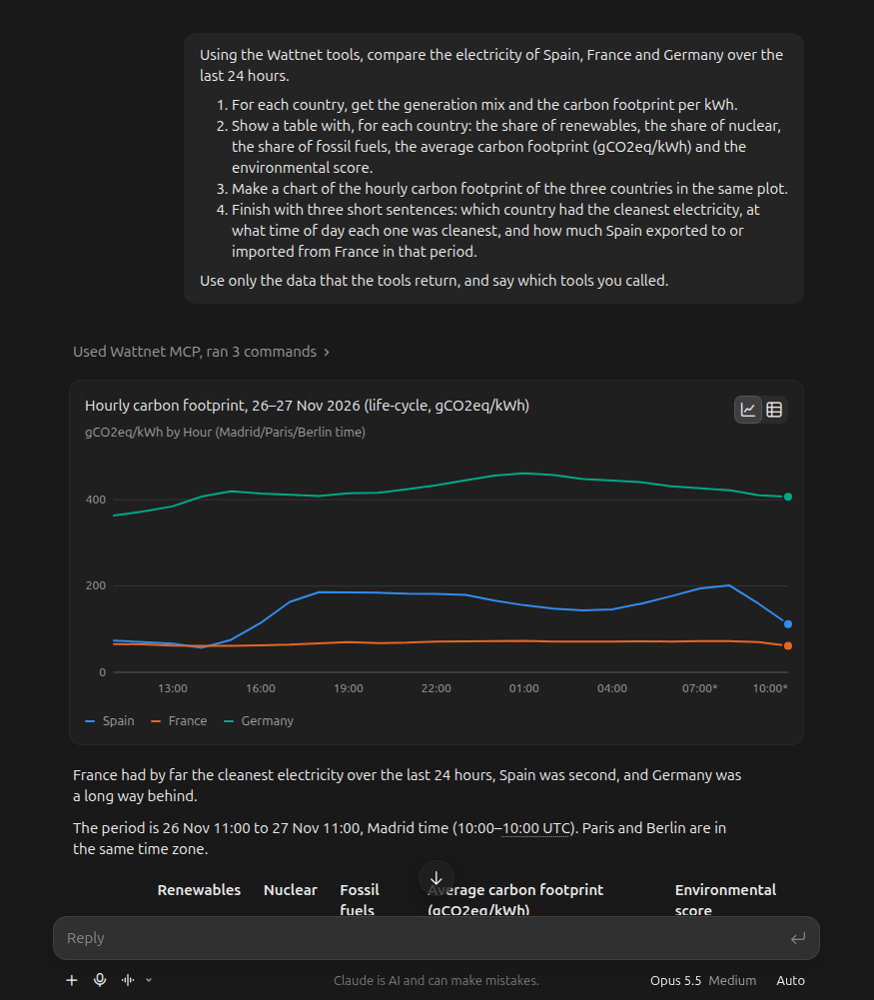
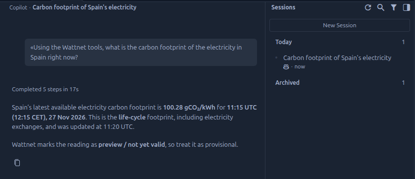
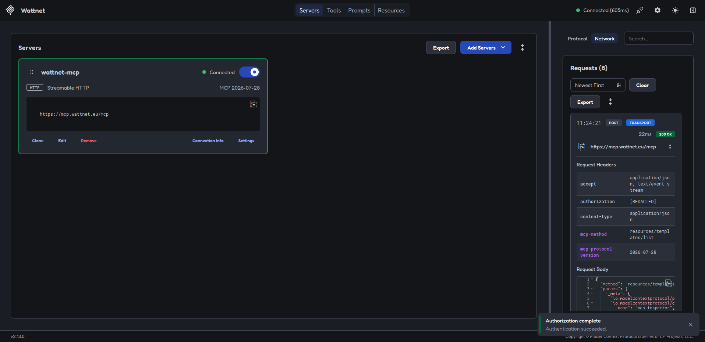
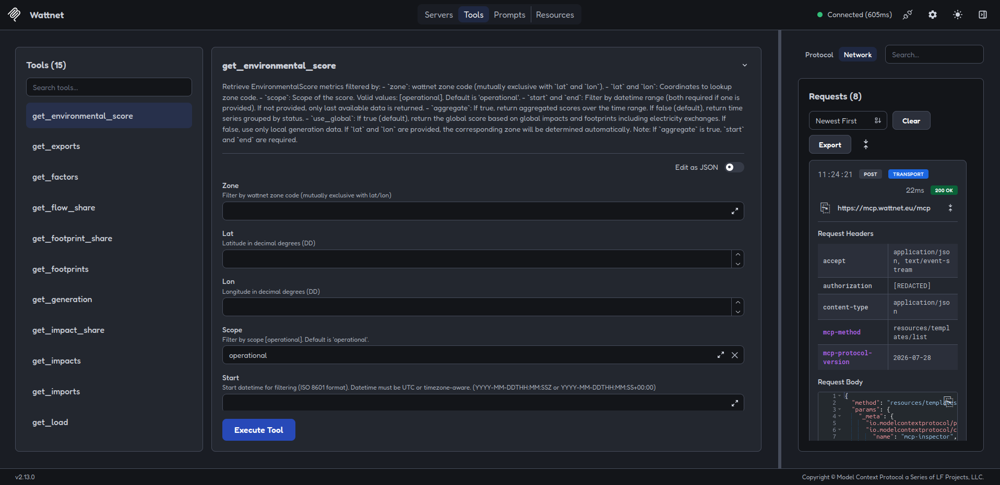

---
tags:
  - MCP
  - Guide
---

# Connecting a Client

This page explains how to connect an application or a program to the Wattnet MCP server, at `https://mcp.wattnet.eu/mcp`. [MCP Interface](mcp-interface.md) explains what the server offers.

There are two ways to authenticate, and the server accepts both:

| | Sign in with your account | Credential with a token |
| --- | --- | --- |
| For | A person using an application on their own computer | A program, an agent or a script that runs by itself |
| How | The application opens your browser and you sign in with your Wattnet account | You create a credential in the developer portal and exchange it for a token |
| Renewal | The application renews the token by itself | You or your code ask for a new token every hour |
| Needs | An application that supports OAuth with a client ID | An application or code that can send a header |

In both cases your [access level](../access/user-access-policy.md) is the one of your account. A new account starts at the Free level.

## Sign in with your account

The application starts the sign in by itself: when it calls the server without a token, the answer tells it where to sign in. You then sign in with your Wattnet account in the browser, accept that the application acts on your behalf, and go back to the application, which keeps the token and renews it while you use it. The token lasts 1 hour. An application that keeps your access between sessions, such as claude.ai, can do so for 30 days without use and 90 days at most; then you sign in again. You can end that access at any time from the page of your account.

The server does not offer to register new applications on the fly, so the application has to let you enter the client ID of Wattnet:

| Setting | Value |
| --- | --- |
| Server URL | `https://mcp.wattnet.eu/mcp` |
| Transport | Streamable HTTP |
| OAuth client ID | `wattnet-mcp-client` |
| OAuth client secret | None: it is a public client that uses PKCE |
| Redirect address | An address on your own computer (`http://localhost`, `http://127.0.0.1` or `http://[::1]`, with any port, which the application chooses), or the one of claude.ai |

### Claude Code

Add the server with the client ID:

```bash
claude mcp add --transport http --client-id wattnet-mcp-client wattnet https://mcp.wattnet.eu/mcp
```

Then open Claude Code, run `/mcp`, choose `wattnet` and select **Authenticate**. Your browser opens the Wattnet sign in. Sign in, accept the access and return to Claude Code, which shows the server as connected. You can now ask for data in plain language, for example for the generation of a zone, and Claude Code calls the tools.

This was tested with Claude Code 2.1.331. The option `--client-id` needs a recent version: if your version does not know it, update Claude Code.

### claude.ai

Add Wattnet as a custom connector of your account, with the URL `https://mcp.wattnet.eu/mcp`. In the settings of the OAuth client choose **Use your own OAuth client**, enter the client ID `wattnet-mcp-client` and leave the secret empty. The other two options, the published identity of Claude and the automatic registration, do not work with the Wattnet server.

Connect it: claude.ai opens the Wattnet sign in. Sign in, accept the access and you return to claude.ai, which shows the connector as connected with its 15 tools. Turn the connector on in a conversation and ask for data in plain language.

{ loading=lazy }

### Claude Desktop

Claude Desktop uses the connectors of your claude.ai account, so once the connector is added in claude.ai there is nothing else to set up: sign in to Claude Desktop with the same account and turn the connector on in a conversation. A question that compares several zones makes Claude call several tools and draw the answer:

{ loading=lazy }

### VS Code

VS Code uses MCP servers in the chat of GitHub Copilot. Open the Command Palette, run **MCP: Add Server…**, choose **HTTP**, enter the URL `https://mcp.wattnet.eu/mcp` and the name `wattnet`, and save it in your user settings. The same can be written by hand in the `mcp.json` of your user:

```json
{
  "servers": {
    "wattnet": { "type": "http", "url": "https://mcp.wattnet.eu/mcp" }
  }
}
```

When the server starts, VS Code asks you to authenticate. It cannot register itself, so it asks for a client ID: enter `wattnet-mcp-client` and leave the secret empty. Your browser opens the Wattnet sign in; sign in, accept the access and return to VS Code. Open the chat in **Agent** mode, the only one that calls tools, check in the tools button that the Wattnet tools are selected, and ask for data in plain language. VS Code asks before it runs a tool.

{ loading=lazy }

### MCP Inspector

The MCP Inspector is a tool to see the server working, with every request and answer:

```bash
npx @modelcontextprotocol/inspector
```

In the page that opens, add a server with the transport **Streamable HTTP** and the URL `https://mcp.wattnet.eu/mcp`, and set the OAuth client ID `wattnet-mcp-client` in its settings. Connect it: your browser opens the Wattnet sign in, and once you accept the access the server shows as connected. The panel on the right lists every request and answer, with the token hidden.

{ loading=lazy }

The **Tools** tab lists the 15 tools with their description and their fields. Fill the fields of one and select **Execute Tool** to see its answer.

{ loading=lazy }

This was tested with the MCP Inspector 2.13.0.

### Other applications

Any application that lets you enter the URL of an MCP server and an OAuth client ID should work with the values above. Wattnet has tested Claude Code, claude.ai, Claude Desktop, VS Code and the MCP Inspector. Applications that only offer to register themselves dynamically are not supported.

## Credential with a token

A program authenticates with the same credential as the [RESTful API](../api/api-access.md): a `client_id` and a `client_secret` that you create in the developer portal and exchange for a Bearer token with the OAuth 2.0 `client_credentials` grant. Steps 1 and 2 of [API Access](../api/api-access.md) explain how. A credential works for the API and for the MCP server: it carries both audiences.

A credential created before the MCP server existed only works for the API and gets a `403` here. Create a new one.

A token is valid for 1 hour. A program that runs for longer has to ask for a new one before it expires, which any standard OAuth library does for you.

Give the client the address of the server and the token as a header. Most MCP clients take them in a configuration like this one, whose exact names depend on the client:

```json
{
  "mcpServers": {
    "wattnet": {
      "url": "https://mcp.wattnet.eu/mcp",
      "headers": { "Authorization": "Bearer <your_token>" }
    }
  }
}
```

To see it work by hand, ask for the list of tools:

```bash
curl -s https://mcp.wattnet.eu/mcp \
  -H "Authorization: Bearer <your_token>" \
  -H "Content-Type: application/json" \
  -H "Accept: application/json, text/event-stream" \
  -d '{"jsonrpc":"2.0","id":1,"method":"tools/list"}'
```

And call one of them, here the generation of a zone:

```bash
curl -s https://mcp.wattnet.eu/mcp \
  -H "Authorization: Bearer <your_token>" \
  -H "Content-Type: application/json" \
  -H "Accept: application/json, text/event-stream" \
  -d '{"jsonrpc":"2.0","id":2,"method":"tools/call","params":{"name":"get_generation","arguments":{"zone":"ES"}}}'
```

## Limits when you connect

The limits are counted per account, so the sign in of an application, your credentials and every other client share them. An application that connects makes several requests at once (the list of tools and a few more), so each connection uses a few of the requests of your minute and a few of the concurrent ones. If you reconnect many times in a row you can reach the limit of your level, and the server answers `429` with a `Retry-After` header: wait that long and try again.

## Troubleshooting

| Problem | Likely cause and fix |
| --- | --- |
| `401 Unauthorized` | There is no token, it has expired or it is not valid. With a sign in, authenticate again from the application. With a credential, ask for a new token. |
| `403 Forbidden` | The token is for another service, or the account has no access level. A credential created before the MCP server existed only works for the API: create a new one. |
| `429 Too Many Requests` | You went over the requests per minute or the concurrent requests of your level. Wait the seconds of `Retry-After`. |
| The sign in page says the redirect address is not valid | The application uses an address that is not on your own computer nor the one of claude.ai. Use an application that signs in through `localhost`, `127.0.0.1` or `[::1]`. |
| The application says it cannot register itself, or the sign in fails at once | It tries dynamic registration or its own published identity, which the server does not offer. Enter the client ID `wattnet-mcp-client` instead. |
| The assistant knows the Wattnet tools but says it cannot call them | The tools are off in that conversation. In VS Code use the **Agent** mode and select the tools in the tools button; in claude.ai and Claude Desktop turn the connector on. |
| A tool answers with `isError` | You asked for more than your level allows. Read the `code` in the text of the result, which is explained in [Querying the API](../api/api-usage.md#limits-of-your-access-level). |
